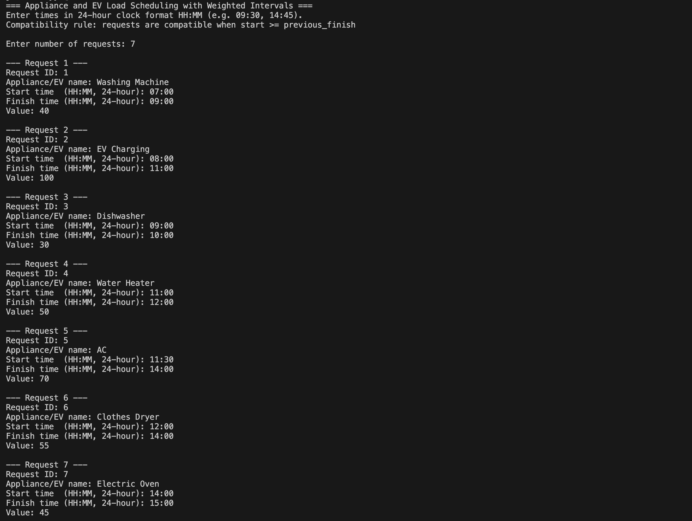
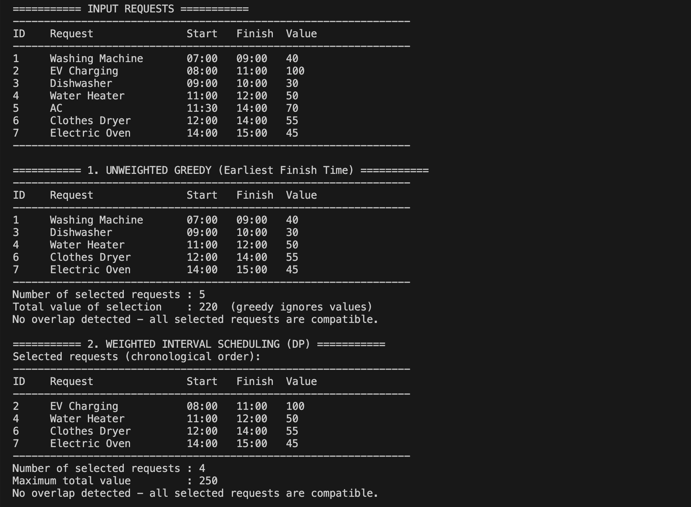
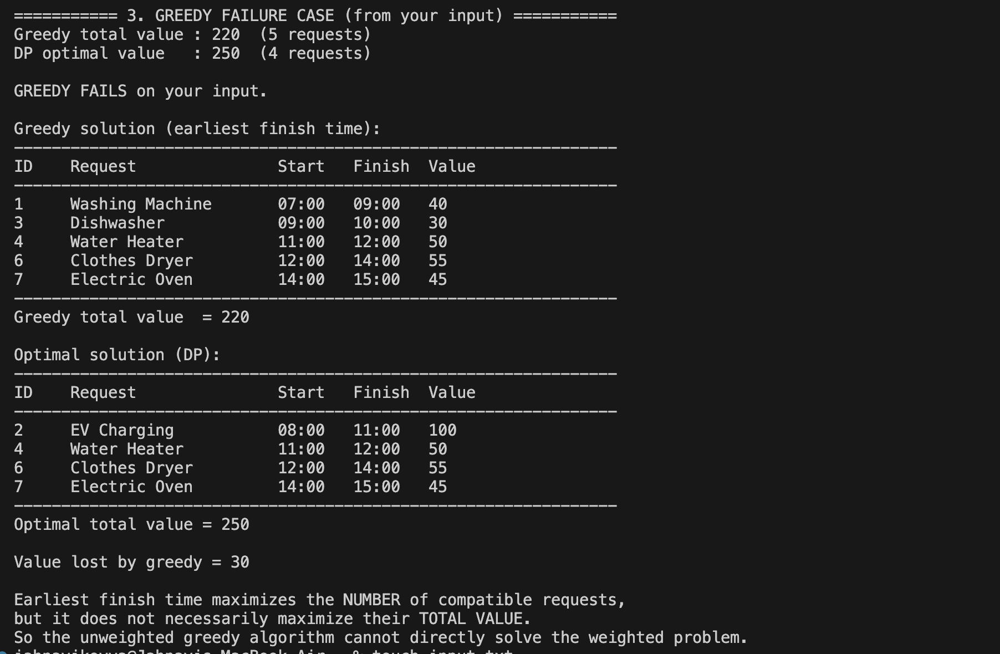
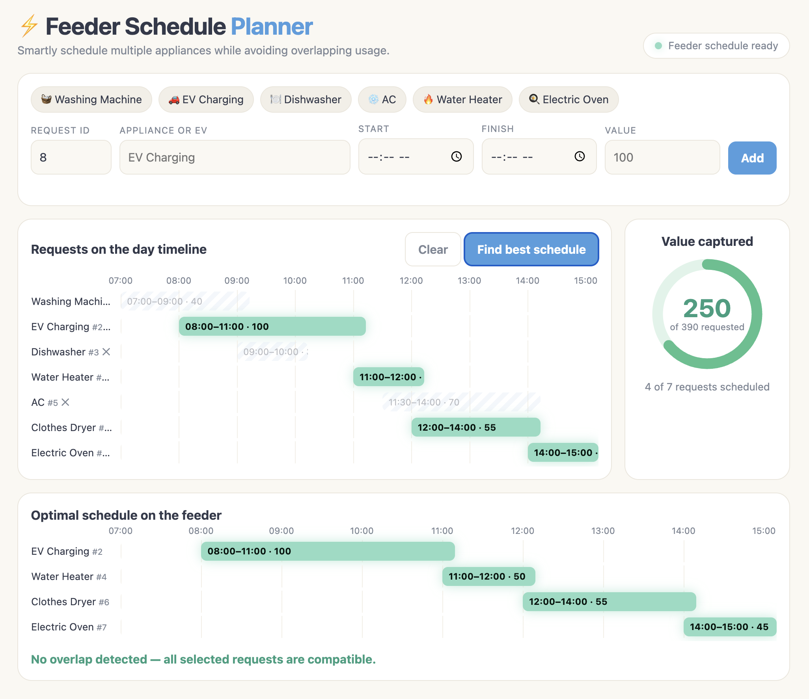

# Appliance and EV Load Scheduling with Weighted Intervals

A DAA (Design and Analysis of Algorithms) project. A smart home has **one shared electrical feeder**. Appliances and an EV request the feeder during time windows, and each request has a value (priority, comfort or revenue). Only one request can use the feeder at a time, so no two selected requests may overlap.

The project compares two algorithms:

| | Greedy | Dynamic Programming |
|---|---|---|
| Problem | Unweighted interval scheduling | Weighted interval scheduling |
| Goal | Maximum **number** of requests | Maximum **total value** |
| Decision | Earliest finish time | Include / exclude |
| Binary search | No | Yes (for p(i)) |
| Backtracking | No | Yes |
| Optimal for the weighted case | No | Yes |
| Time / space | O(n log n) / O(n) | O(n log n) / O(n) |


## Algorithms

**Greedy (earliest finish time):** sort by finish time and keep a request if its start is at or after the last selected finish. It is optimal for the number of requests (exchange-argument proof), but it ignores values, so it can fail on weighted requests.

**Weighted DP:** sort by finish time, find `p(i)` (the last request compatible with request `i`) using binary search, then fill

```
DP[i] = max( value[i] + DP[p(i)] , DP[i-1] )
```

and backtrack from `DP[n]` to list the chosen requests. The program then verifies that no two selected requests overlap.

## Features

- Request input with ID, name, start time, finish time (24-hour `HH:MM`) and value.
- Appliance names unique request IDs and letters-only.
- Greedy and DP results with an automatic overlap check.
- Greedy failure check computed from your own input.
- Web page (`FeederSchedulePlanner/index.html`) with a timeline view and a "Value captured" ring.

## Project structure

```
.
├── index.html           (Web page)
├── README.md
├── .gitignore
├── src/
│   └── scheduler.cpp          C++ program (console)
├── samples/
│   ├── input.txt   Sample input
│   └── output.txt  Output for the sample input
└── screenshots/
    ├── Input.png
    ├── Output1.png
    ├── Output2.png
    └── Webpage.png
     
```

## How to run the C++ program

```bash
g++ src/scheduler.cpp -o scheduler
./scheduler
```

To try the sample input:

```bash
./scheduler < samples/input.txt
```

## How to open the web page

Open `index.html` in a browser. No installation is needed.

Live page: Not Available yet.

## Sample result

Input: 7 requests (Washing Machine, EV Charging, Dishwasher, Water Heater, AC, Clothes Dryer, Electric Oven).

| Algorithm | Requests selected | Total value |
|---|---|---|
| Greedy | 5(Washing Machine, Dishwasher, Water Heater, Clothes Dryer, Electric Oven) | 220 |
| Dynamic Programming | 4 (EV Charging, Water Heater, Clothes Dryer, Electric Oven) | **250** |

Greedy loses 30 in value, which shows why DP is needed for weighted requests. The full output is in `samples/output.txt`.

## Screenshots

**Program input**



**Program output**




**Web page**



